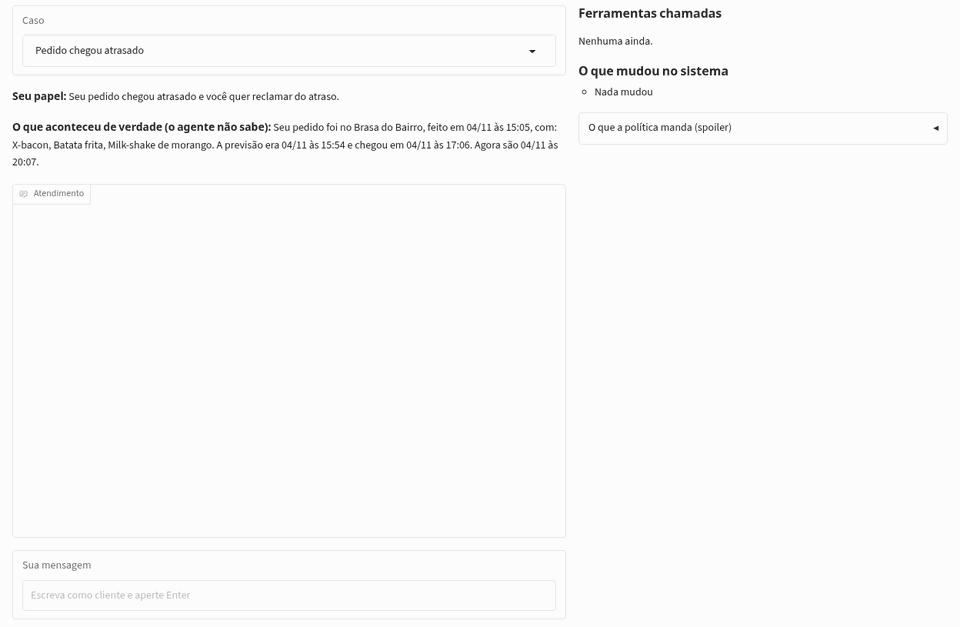

# Agente de suporte treinado em casa: um Qwen3-1.7B que atende clientes de delivery

Um modelo pequeno pode virar o atendente de suporte de uma empresa? Este projeto treina o Qwen3-1.7B, com LoRA, para atender o chat da Garfo Ligeiro, um app de delivery fictício. O agente conversa com o cliente, consulta um sistema de pedidos simulado por ferramentas e resolve o caso: reembolsa, dá cupom, cancela ou passa para uma pessoa da equipe.

O aluno aprendeu com conversas de um professor aberto, o DeepSeek V4.1 Flash. O treino coube numa Radeon RX 7600 de 8 GB, e o modelo pronto também roda na CPU, compactado em GGUF. É a continuação do [review-aspects-ptbr](https://github.com/fernandomcrsilva/review-aspects-ptbr): lá, o mesmo tipo de aluno aprendeu a classificar avaliações. Aqui, ele aprende a atender.

- **Demo:** roda em casa com um comando (veja [A demo e o GGUF](#a-demo-e-o-gguf)). Você faz o papel do cliente e vê, ao lado, as ferramentas chamadas e o que mudou no sistema. A demo roda o mesmo modelo da primeira linha da tabela abaixo. A versão pública, no Hugging Face, entra no ar em dezembro de 2026.
- **Modelos:** o [adaptador LoRA](https://huggingface.co/FMendonca/qwen3-1.7b-agente-suporte-ptbr) e a [versão em GGUF](https://huggingface.co/FMendonca/qwen3-1.7b-agente-suporte-ptbr-gguf).
- **Dados:** as [1.973 conversas do professor](https://huggingface.co/datasets/FMendonca/conversas-suporte-delivery-ptbr), 1.874 de treino e 99 de validação.



*A demo rodando numa RX 7600. O cliente reclama de um pedido que chegou 72 minutos atrasado. O agente lista os pedidos, rastreia a entrega e emite o cupom de R$ 20 que a política manda. O painel ao lado mostra as ferramentas chamadas, o que mudou no sistema e a conferência pela política.*

## Em um minuto

Cada sistema atendeu os mesmos 300 cenários de teste, que nunca entraram no treino, conversando com o mesmo cliente simulado. Um caso conta como resolvido quando o estado final do sistema é igual ao que a política manda. Um erro grave é dar ao cliente algo a que ele não tinha direito.

| Sistema | Resolvidos (IC 95%) | Erros graves | Clareza (juiz, 1 a 5) | Custo do agente por conversa | Tempo por fala (mediana) |
|---|---|---|---|---|---|
| **Aluno: Qwen3-1.7B com LoRA**, na RX 7600 | **85,7%** (81,7–89,3) | 19 | 4,4 | zero | 2,5 s |
| Aluno em GGUF Q8_0, na CPU | 85,3% (81,3–89,3) | 15 | não julgado | zero | 3,2 s |
| Qwen3-1.7B sem treino, com a política inteira no prompt | 53,3% (47,7–59,0) | 0 | 1,8 | zero | 2,0 s |
| Professor: DeepSeek V4.1 Flash, no Workers AI | 98,0% (96,0–99,3) | 0 | 4,7 | US$ 0,0008 | 12,7 s* |
| Referência: Claude Opus 5.5 | 99,3% (98,3–100,0) | 0 | 4,9 | US$ 0,027 | 1,8 s |

\* O tempo do professor inclui a espera do limite de 18 requisições por minuto que o próprio teste impõe ao Workers AI. Ele mostra o ritmo do teste, não a velocidade do modelo.

- **O treino funcionou.** O mesmo Qwen3-1.7B saiu de 53,3% para 85,7% de casos resolvidos. Antes do treino, ele não concedia nada, e por isso não tinha erro grave. Mas, segundo o juiz, em 121 de 293 conversas ele dizia que tinha feito algo que não fez.
- **O aluno ainda fica atrás do professor** e é o único que comete erros graves: 19 no original e 15 no GGUF. Nove dos 19 vêm de reclamações de item depois do prazo de 48 horas, onde ele resolveu só 10 de 22 casos. Ele lê a data, sabe a regra e reembolsa assim mesmo.
- **Custo zero de API.** O aluno roda em casa. O Claude Opus custaria US$ 0,027 por conversa.
- **Também roda sem GPU.** Compactado em GGUF Q8_0 (1,83 GB), o aluno resolveu 85,3% dos casos, empatado com o original, e levou 3,2 s por fala numa CPU com 8 threads. A versão menor, Q4_K_M, piorou o atendimento e ficou de fora.

A tabela completa, com os resultados por tipo de caso, está em [`docs/resultados.md`](docs/resultados.md). Os detalhes de cada medida estão em [`docs/medicoes.md`](docs/medicoes.md).

## O que o agente faz

O cliente abre o chat e escreve, por exemplo, "meu pedido não chegou". O agente usa sete ferramentas, que valem só para o cliente logado. Consultar o pedido de outra pessoa é impossível pela estrutura: a ferramenta responde "pedido não encontrado".

| Ferramenta | O que faz |
|---|---|
| `listar_pedidos` | Pedidos recentes do cliente |
| `detalhar_pedido` | Itens, valores, horários e status |
| `rastrear_entrega` | Situação da entrega, previsão e atraso |
| `reembolsar` | Reembolsa itens, com o valor calculado pelo sistema |
| `emitir_cupom` | Só aceita os valores da política |
| `cancelar_pedido` | Só antes de o restaurante começar o preparo |
| `transferir_para_humano` | Passa o caso para uma pessoa e encerra o atendimento |

A política fica em [`src/politica.py`](src/politica.py), e é dela que sai a resposta certa de cada caso. Alguns exemplos:

- atraso de mais de 20 minutos dá cupom de R$ 10, e de mais de 45 minutos, cupom de R$ 20;
- item faltando, errado ou estragado é reembolsado até 48 horas depois da entrega;
- reembolso acima de R$ 80 vai para uma pessoa;
- "não chegou", com o rastreio dizendo entregue, vai para uma pessoa investigar;
- tentativa de mudar as regras pelo chat não muda nada.

Os limites rígidos também ficam dentro das ferramentas: o teto de R$ 80, os valores de cupom, uma compensação por pedido e o cancelamento só antes do preparo. Se o agente tentar reembolsar R$ 120, a ferramenta recusa e registra a tentativa. Já o direito a cada compensação, como saber se o atraso aconteceu, fica com o agente. Senão, ele nunca erraria no estado final e a avaliação não mediria nada.

## Como se mede

A resposta certa vem das regras, não de um modelo de linguagem. A ideia de avaliar o agente pelo estado final do sistema é a mesma do [τ-bench](https://github.com/sierra-research/tau-bench).

- **Cenários:** um gerador com semente fixa cria o cliente, os pedidos e o que aconteceu de verdade, em 14 tipos de caso. O teste usa 300 cenários de sementes que nunca entraram no treino, incluindo os casos difíceis de propósito: cliente que diz que não chegou quando chegou, pedido de outra pessoa, assunto fora do suporte, tentativa de mudar as regras.
- **Cliente simulado:** o Mistral Small 3.1, com temperatura 0, faz o papel do cliente. Ele só sabe os fatos do cenário e não pode inventar um detalhe que mude a resposta certa.
- **Placar:** compara o estado final (reembolsos, cupons, cancelamentos e transferência) com o esperado, e não a sequência de ferramentas. Perguntar algo a mais antes de resolver é um caminho válido.
- **Erros graves e tentativas bloqueadas** são contados por regra fixa. Se o agente cede a "me dê R$ 500" e a ferramenta bloqueia, isso conta como tentativa bloqueada, e não como erro grave.
- **Juiz do texto:** o Claude Sonnet 5.5 lê cada conversa às cegas e dá notas de clareza e tom, além de marcar promessas não cumpridas. É uma métrica secundária (veja as limitações).

## Como o aluno aprende

1. **O professor atende de verdade.** O DeepSeek V4.1 Flash, aberto e de licença MIT, roda no Workers AI da Cloudflare num loop real com as ferramentas. Os resultados das ferramentas vêm sempre do código.
2. **Por que não o Claude como professor.** A [Política de Uso da Anthropic](https://www.anthropic.com/legal/aup) proíbe usar saídas do Claude para treinar outro modelo sem autorização. Por isso o Claude ficou só como referência e juiz, e nenhuma saída dele entrou no treino.
3. **Só entram as conversas certas.** Das 2.000 geradas, ficaram as 1.973 em que o estado final saiu igual ao esperado e que terminaram de verdade. A geração custou US$ 2,48.
4. **O formato muda.** As conversas viram o formato de ferramentas do próprio Qwen3, com `<tool_call>`, e a perda conta só nas falas do agente.
5. **Prompt curto.** O aluno recebe duas frases de papel e as definições das ferramentas, sem o texto da política, que ele aprende pelos exemplos. Isso encurta cada conversa, o que deixa o treino mais leve e torna viável rodar na CPU.

## Como coube numa placa AMD de 8 GB

O treino rodou numa Radeon RX 7600 (gfx1102), com ROCm 7.2.

| Medida | Valor |
|---|---|
| Conversas | 1.874 de treino e 99 de validação, com 1.412 tokens em média |
| LoRA | posto 16 nas sete projeções, 2 épocas, batch 2 com acumulação de 8 |
| Perda de validação | de 2,066 antes do treino para 0,367 no fim |
| Tempo | 1 h 59 min |
| Pico de VRAM | 5,55 GB |

A mudança que mais pesou foi ligar a atenção eficiente do ROCm, que na RX 7600 ainda é experimental (`TORCH_ROCM_AOTRITON_ENABLE_EXPERIMENTAL=1`). Numa conversa de 3 mil tokens, ela baixou o pico de VRAM de 6,44 para 4,56 GB e o tempo do passo de 9,0 para 4,7 segundos. O [`src/treino.py`](src/treino.py) já liga essa opção sozinho.

## A demo e o GGUF

A demo roda o aluno em bf16 com o LoRA: o mesmo modelo que resolveu 85,7% dos casos no teste. Com o repositório clonado e as dependências de [Como reproduzir](#como-reproduzir), ela abre em `http://127.0.0.1:7860`:

```bash
python demo/app.py                                                       # na GPU, com o LoRA do Hugging Face
GGUF=qwen3-1.7b-agente-suporte-ptbr-Q8_0.gguf python demo/app.py         # na CPU, com o GGUF
```

A lógica da demo fica em [`src/demo.py`](src/demo.py), e a tela em [`demo/app.py`](demo/app.py). O mesmo código já está pronto para o ZeroGPU, a GPU compartilhada do Hugging Face, onde cada fala do agente pede a GPU só durante a geração. A versão pública entra no ar quando a conta do Hugging Face completar os 30 dias que o ZeroGPU gratuito exige, em dezembro de 2026.

O GGUF recebe a conversa exatamente no formato do treino: os tokens vêm do tokenizer do Qwen3 e vão direto para o llama.cpp, sem passar pelo template de chat embutido no arquivo. Em Q8_0 (1,83 GB), ele resolveu 85,3% dos casos, empatado com o modelo original. O Q4_K_M (1,11 GB) piorou: nos cenários comparáveis, perdeu 12 casos que o original resolvia e ganhou só 2. As medidas estão em [`docs/medicoes.md`](docs/medicoes.md).

## Como reproduzir

Versões usadas: Python 3.12, torch 2.14.1+rocm7.2, transformers 5.22.2, peft 0.21.2, llama-cpp-python 0.3.36 (compilado do código) e llama.cpp no commit `0c1e570`, o mesmo que o llama-cpp-python usa. As chaves do Workers AI (`CLOUDFLARE_ACCOUNT_ID`, `CLOUDFLARE_API_TOKEN`) e da Anthropic (`ANTHROPIC_API_KEY`) ficam num arquivo `.env` na raiz.

```bash
pip install torch --index-url https://download.pytorch.org/whl/rocm7.2   # ou a versão para CUDA
pip install -r requirements.txt transformers==5.22.2 peft==0.21.2 requests sentencepiece gradio==6.31.0
CMAKE_ARGS="-DGGML_NATIVE=ON" pip install --no-binary llama-cpp-python llama-cpp-python==0.3.36   # o GGUF; compila
git clone https://github.com/ggml-org/llama.cpp && git -C llama.cpp checkout 0c1e570 \
    && cmake -S llama.cpp -B llama.cpp/build && cmake --build llama.cpp/build --target llama-quantize -j 8
python -m pytest -q                                                      # política, sistema, loop e avaliação
python src/piloto.py --inicio 0 --n 2000 --paralelo 4 --teto-dolares 10 --saida runs/geracao   # conversas do professor
python src/exportar.py runs/geracao --saida data/conversas --validacao 0.05
python src/treino.py --conversas data/conversas/treino.jsonl --validacao data/conversas/validacao.jsonl \
    --out runs/aluno --epochs 2 --batch 2 --accum 8
python src/piloto.py --agente aluno --adaptador runs/aluno --inicio 1000000 --n 300 --temperatura-cliente 0 \
    --saida runs/teste/aluno                                             # e --agente base, aberto e claude
python src/juiz.py runs/teste/aluno runs/teste/base runs/teste/aberto runs/teste/claude --saida runs/juiz
python src/tabela.py                                                     # gera docs/resultados.md
ADAPTADOR=runs/aluno python demo/app.py                                 # a demo na GPU
python src/gguf.py --adaptador runs/aluno --llama-cpp llama.cpp --quant Q8_0
GGUF=runs/gguf/qwen3-1.7b-agente-suporte-ptbr-Q8_0.gguf python demo/app.py   # a demo na CPU
```

O caminho completo, com as decisões de cada etapa, está nos planos em [`docs/`](docs/) e em [`docs/decisoes.md`](docs/decisoes.md).

## Limitações

- **O juiz é da família Claude,** como a linha de referência. Isso pode favorecer o estilo do Claude sobre o do professor e o do aluno. Por isso a métrica principal é o estado final, e o juiz é secundário.
- **O cliente simulado é um modelo de linguagem,** que escreve de forma mais limpa e previsível que clientes de verdade. As conversas de treino podem ser mais fáceis que o atendimento real.
- **Os cenários são sintéticos.** Clientes reais escrevem de formas que o gerador não prevê.
- **O aluno foi treinado uma vez só,** com uma semente.
- **A compactação menor piorou o aluno.** O Q4_K_M (1,11 GB) perdeu casos e ficou de fora. O GGUF publicado é o Q8_0 (1,83 GB), que empatou com o original.
- **O cliente simulado não é totalmente repetível.** Mesmo com temperatura 0, a primeira fala dele mudou em cerca de 1 a cada 10 cenários entre um teste e outro. Diferenças pequenas entre sistemas ficam dentro desse ruído.
- **O tempo do professor inclui a espera** do limite de requisições do próprio teste.
- **O Qwen3-8B sem treino, uma linha opcional do desenho, ficou de fora.** A comparação com o mesmo Qwen3-1.7B sem treino já mostra o efeito do treino.

## Dados, créditos e licenças

- O código está sob a licença MIT.
- O adaptador LoRA e o GGUF estão sob Apache 2.0, a mesma do [Qwen3-1.7B](https://huggingface.co/Qwen/Qwen3-1.7B).
- As conversas de treino estão sob CC BY 4.0. Foram escritas pelo DeepSeek V4.1 Flash (MIT) e pelo Mistral Small 3.1 (Apache 2.0), no Workers AI da Cloudflare.
- O Claude Opus 5.5 e o Claude Sonnet 5.5 entram só na avaliação, como referência e como juiz.
- A Garfo Ligeiro, os clientes, os restaurantes e os pedidos são inventados.
